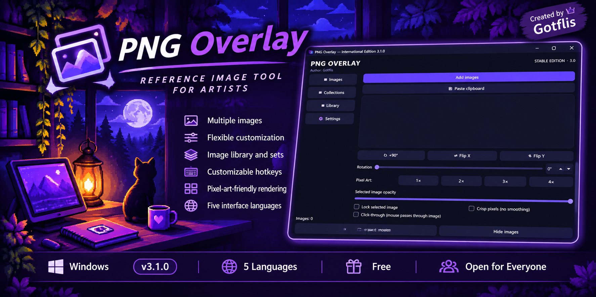
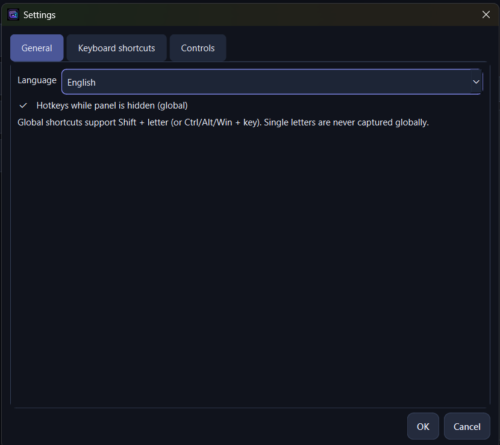
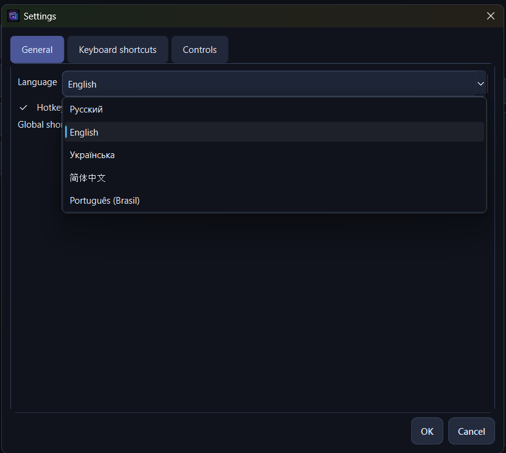

# PNG Overlay

**Keep your references in sight. Create without interruptions.**

## About

**PNG Overlay** is a lightweight Windows application designed for pixel artists, illustrators, and digital creators.

Keep reference images visible above your workspace without constantly switching between windows.

## Features

- **Multiple images** — Display several references simultaneously.
- **Flexible customization** — Adjust opacity, size, rotation, and flipping.
- **Pixel-art-friendly rendering** — Keep pixel art crisp while scaling.
- **Image library and sets** — Organize references for different projects.
- **Customizable hotkeys** — Control your workspace quickly.
- **Click-through mode** — Interact with applications behind reference images.
- **Multilingual interface** — Choose from five supported languages.

## Supported Languages

🇬🇧 English  
🇷🇺 Русский  
🇺🇦 Українська  
🇨🇳 简体中文  
🇧🇷 Português (Brasil)

## Screenshots

### PNG Overlay in Action

Display multiple reference images directly above your creative workspace without switching between windows.

### Library Search

Quickly find reference images by filename. Search results update as you type.

| Before Search | After Search | 
|:---:|:---:|
|  |  |

### Settings & Customization

Customize PNG Overlay to fit your workflow. Choose from five interface languages, configure keyboard shortcuts, and control whether global hotkeys remain active when the control panel is hidden.

#### General Settings

#### Languages & Keyboard Shortcuts

| Five Interface Languages | Customizable Keyboard Shortcuts |
|:---:|:---:|
|  |  |

## Installation

The first public release is currently being prepared.

Once testing is complete, the Windows installer will be available in the **Releases** section.

## Feedback

Found a bug or have a suggestion? Feel free to open an issue in this repository after the public release.

---

**Created by Gotflis 💜**

*Made with care for artists and creators.*
