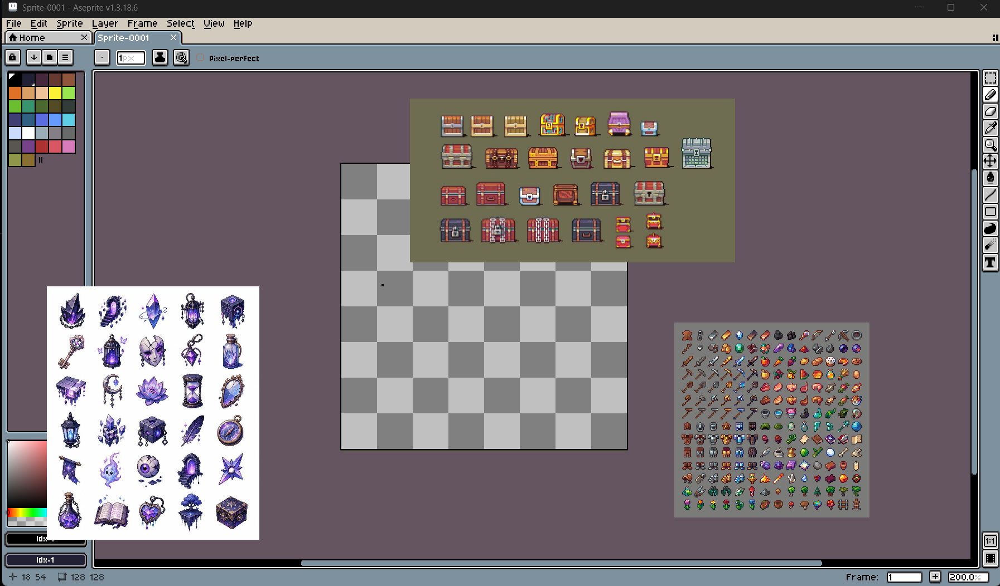
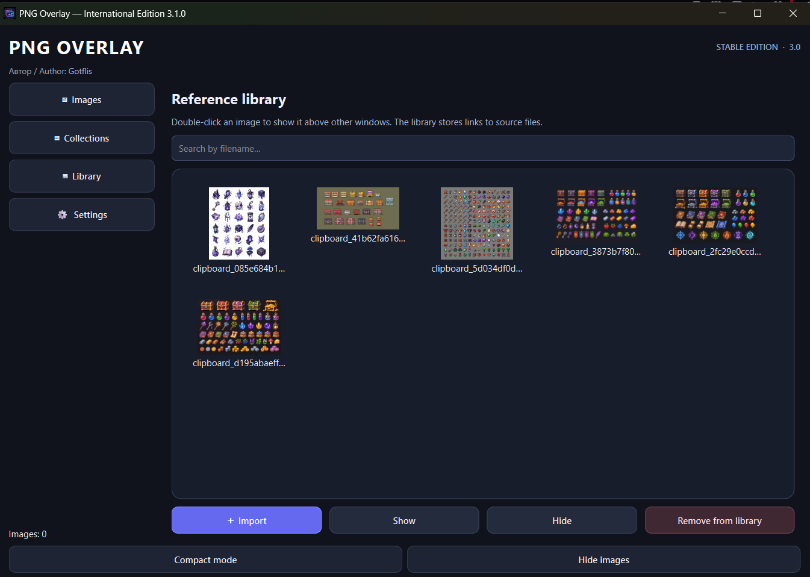
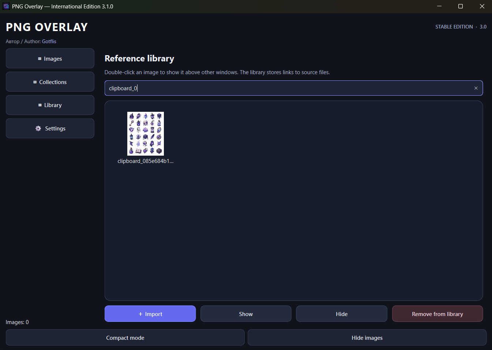
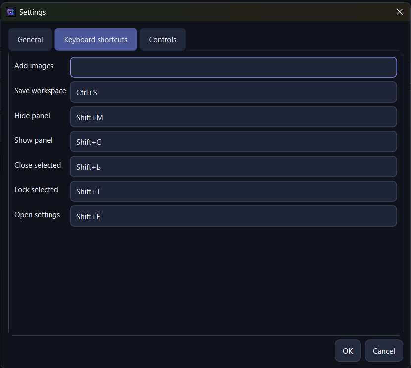

# PNG Overlay

**Keep your references in sight. Create without interruptions.**

  
   
  Windows x64 · Free

## About

**PNG Overlay** is a lightweight Windows application designed for pixel artists, illustrators, and digital creators.

Keep reference images visible above your workspace without constantly switching between windows.

## Features

- **Multiple images** — Display several references simultaneously.
- **Flexible customization** — Adjust opacity, size, rotation, and flipping.
- **Pixel-art-friendly rendering** — Keep pixel art crisp while scaling.
- **Image library and sets** — Organize references for different projects.
- **Customizable hotkeys** — Control your workspace quickly.
- **Click-through mode** — Interact with applications behind reference images.
- **Multilingual interface** — Choose from 11 supported languages.
- **Automatic language detection** — Automatically selects your system language on first launch.

## 🌍 Supported Languages

PNG Overlay supports 11 interface languages:

- 🇬🇧 English
- 🇺🇦 Українська
- 🇷🇺 Русский
- 🇨🇳 简体中文
- 🇧🇷 Português (Brasil)
- 🇯🇵 日本語
- 🇪🇸 Español
- 🇰🇷 한국어
- 🇩🇪 Deutsch
- 🇫🇷 Français
- 🇵🇱 Polski

PNG Overlay automatically detects your system language on first launch. If your system language is not supported, English will be used by default.

You can manually change the interface language at any time in Settings.

## Screenshots

### PNG Overlay in Action

Display multiple reference images directly above your creative workspace without switching between windows.

### Library Search

Quickly find reference images by filename. Search results update as you type.

| Before Search | After Search | 
|:---:|:---:|
|  |  |

### Settings & Customization

Customize PNG Overlay to match your workflow.

#### Global Hotkeys

Keep keyboard shortcuts active even when the control panel is hidden.

#### Eleven Interface Languages

Choose from 11 supported interface languages.
PNG Overlay automatically detects your system
language on first launch.

#### Customizable Keyboard Shortcuts

Assign your preferred shortcuts for common actions.

## 💻 System Requirements

- Windows 10 / Windows 11 (64-bit)
- No additional software required

PNG Overlay is designed for Windows desktop environments.

## 📥 Installation

1. Open the [Releases](https://github.com/Gotflis/PNG-Overlay/releases/latest) page.
2. Download `PNG-Overlay-Setup-3.2.1.exe`.
3. Run the installer.
4. Follow the installation instructions.
5. Launch PNG Overlay and enjoy!

PNG Overlay is distributed as a ready-to-use Windows application. No Python installation or additional dependencies are required.

## 🗑️ Uninstallation & User Data

PNG Overlay uses two separate folders:

- **Installation folder:** Contains the application and its uninstaller. The location is selected during installation.
- **User data folder:** `%USERPROFILE%\AppData\Roaming\PNGOverlay`

The standard uninstaller removes the application but preserves the user data folder, allowing you to restore your settings and saved collections after reinstalling.

### Complete removal

If you want to completely remove PNG Overlay and all associated user data:

1. Uninstall PNG Overlay through Windows Settings.
2. Press `Win + R`.
3. Enter `%USERPROFILE%\AppData\Roaming`.
4. Locate and manually delete the `PNGOverlay` folder.

**Warning:** Deleting this folder permanently removes saved settings, keyboard shortcuts, collections, reference library data and images saved from the clipboard.

Keep this folder if you plan to reinstall the application in the future.

## 💬 Feedback & Support

Found a bug, encountered a performance issue, noticed a translation error, or have an idea for a new feature?

Feel free to open an [issue on GitHub](https://github.com/Gotflis/PNG-Overlay/issues).

When reporting a bug, please include:

- PNG Overlay version
- Windows version
- Description of the issue
- Steps to reproduce the issue
- Screenshots, if available

Your feedback helps improve PNG Overlay and makes it better for everyone.

Thank you for your support! 💜

---

**Created by Gotflis 💜**

*Made with care for artists and creators.*
